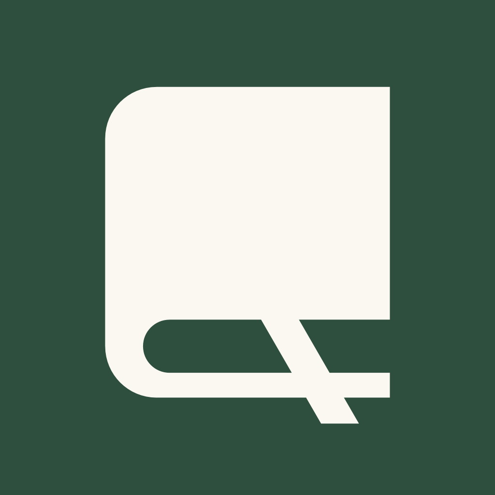

  

<h1 align="center">Bookmarkd</h1>

<strong>Your reading life, beautifully kept.</strong>

Bookmarkd is a quiet home for the books you read. Log where you are in a few taps, see your year fill up
one spine at a time, and find your next book through the people whose taste you trust.

Made for readers, not for feeds: no streaks to protect, no badges to chase, just your books, on a page
that feels like paper.

---

## Log your page in two taps

Open the book you're reading, tap **Log**, type the page you're on. That's it.

- Quick buttons for **+10, +25 and +50 pages**, so a normal evening is one tap.
- A live line tells you how far you've come: *"+25 pages since yesterday · 30%"*.
- Editions without a page count? Log by percentage instead.
- Every update is kept, so you can look back at how a book unfolded, day by day.

## Finishing a book feels like finishing a book

Reach the last page and Bookmarkd marks the moment.

- **"Book 7 of 2026"**: see where it lands in your year, and how many are left for your goal.
- *"880 pages over 41 days"*: a small record of the time you spent with it.
- Watch it join your shelf for the year, outlined in gold.
- Rate it while it's fresh, with a word for every star, from *Not for me* to *A favourite*,
  and write one line about what stayed with you.
- Not ready to rate it yet? Choose **Rate it later**.

## Your year, on a shelf

Every book you finish this year stands as a spine on your **Reading** screen: thicker for the long
ones, each in its own colour. Set a yearly goal and the empty slots show what's still ahead.
Your books in progress sit right above it, with your page, your percentage and the Log button.
The next three books you want to read wait just below.

## A shelf that's actually yours

Everything you've added, sorted the way you think about books:

- **Want to read**, **Reading**, **Finished** and **Did not finish**, because not every book deserves an ending.
- Ratings in **half stars**: 3.5 is a real opinion.
- Mark your **favourites**.
- Start and finish dates, editable whenever you remember better.
- View it as a cover grid or a list, sort it by what matters to you, and filter it by title or author.

## Discover through people, not algorithms

- Search millions of books by **title, author or ISBN**.
- **Friends lately**: see what the readers you follow just started, finished and reviewed,
  with their words quoted right in the feed.
- **On shelves this week**: what's being picked up by readers around you.
- Recommendations come from your **most-read genre**, and Bookmarkd tells you exactly why it suggests something.
- Browse by genre, and find books you viewed recently.

## Every book has its own page

Each book's page takes its colours from the book itself. Alongside the cover and the essentials you'll find:

- the community rating and how many shelves the book is on, counted from real readers only;
- reviews from readers, set as quotes, with spoilers hidden until you choose to read them;
- what the book is about, plus edition details like pages, publisher and ISBN.

Your status and your progress stay pinned at the bottom of the page, one tap away.

## Reviews worth reading

Write as much or as little as you like. Mark a review as containing spoilers and others will only see
it when they choose to. Your reviews live on your profile, alongside the books you've finished and loved.

## Follow readers you trust

Follow friends, and anyone whose taste you like. Like their updates. Visit their profiles to see what
they're reading, what they've finished and what they thought of it.

## Private when you want it

Make your profile private and your library, reviews and activity are visible to you alone.
Bookmarkd never shows invented numbers: every count and rating comes from real readers.

## Easy on the eyes, day and night

A warm paper palette by day and a soft charcoal theme by night, so your reading app doesn't keep you
awake. Book titles and reviews are set in a classic serif, and the covers bring the colour.
Bookmarkd follows your phone's light or dark setting automatically.

---

**Bookmarkd for iPhone and Android.** Keep track of what you read, and why it mattered.
